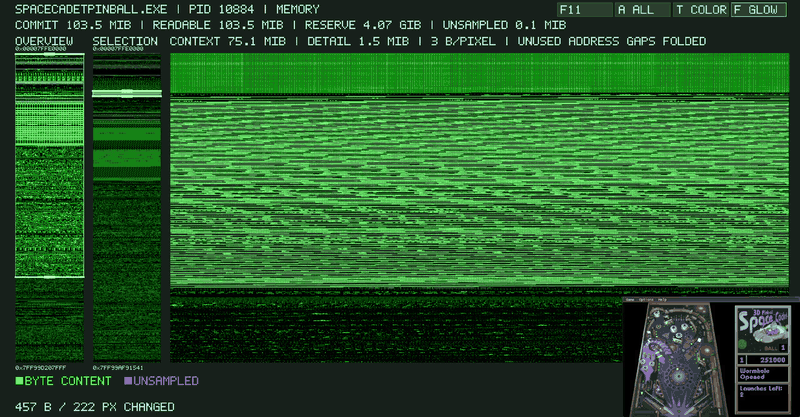
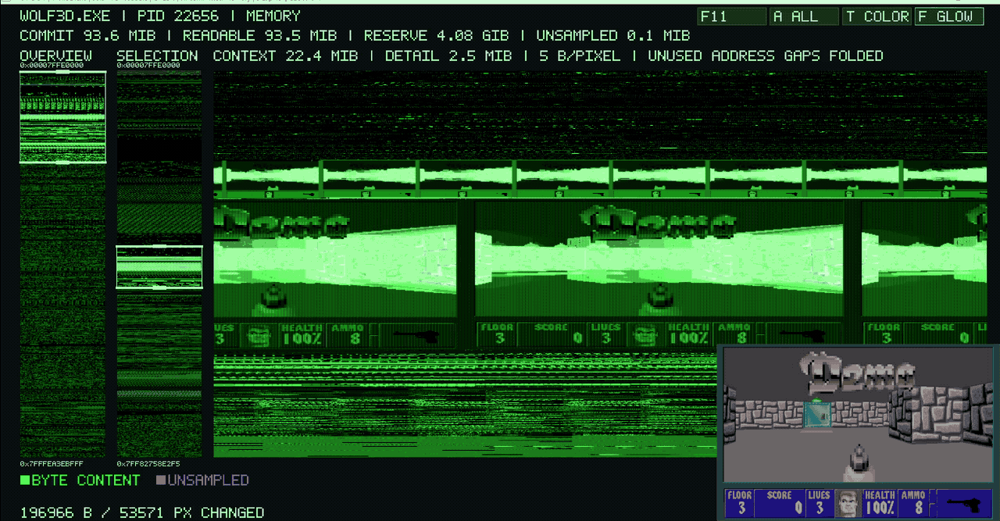

# MemGlow

[English](README.md) | 简体中文

实时可视化程序里的内存画出来

没什么卵用但挺酷的，可以满足一下对黑客的幻想。





## 使用

1. 从 GitHub Releases 下载 Windows x64 ZIP 并解压，`MemGlow.exe` 和 `SDL2.dll` 要放在同一个文件夹。
2. 打开想查看的程序，在任务管理器 → **详细信息**里找到它的 PID。
3. 在解压目录打开 PowerShell，运行：

   ```powershell
   .\MemGlow.exe -p 1234 --all
   ```

把 `1234` 换成目标程序的 PID。如果提示访问被拒绝，试试以管理员身份打开 PowerShell。

## 操作

| 操作 | 效果 |
|---|---|
| 滚动鼠标滚轮 | 三个区域都可以缩放，按住 Shift 和滚轮可以微调。 |
| 按住左键上下拖动 | 平移主画面，或移动左侧柱子的选框。 |
| 拖动选框上、下边缘 | 调整范围；在框外拖动可以重新框选。 |
| 点击 `A ALL` / 按 `A` | 回到全部内存。 |
| 点击 `T COLOR` / 按 `T` | 切换绿色和分类配色。 |
| 点击 `F GLOW` / 按 `F` | 开关内存变化时的发光效果。 |
| `F11` | 切换全屏。 |
| Escape | 退出全屏；窗口模式下关闭程序。 |

其他命令行选项可以用 `--help` 查看。

## 致谢

灵感来自 Christopher Domas 的演讲 [The Future of RE: Dynamic Binary Visualization](https://recon.cx/2013/schedule/events/20.html)。

演示游戏为 [Space Cadet Pinball](https://github.com/k4zmu2a/SpaceCadetPinball) 和 Wolfenstein 3D（[DDWolf](https://github.com/brosseaualex/DDWolf)），发布包不包含游戏。
